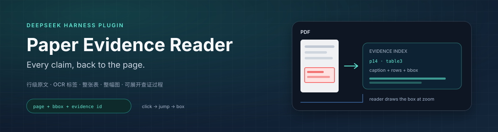
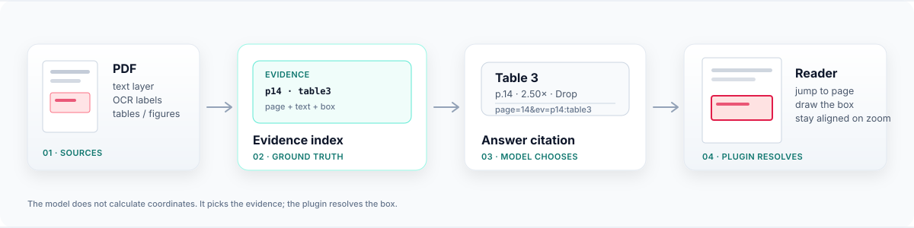

<p align="center">
  <strong>English</strong> · <a href="README.zh-CN.md">简体中文</a>
</p>

<p align="center">
  
</p>

<p align="center">
  <a href="https://github.com/Raymond2967/dsh-paper-reader-evidence/actions/workflows/ci.yml"></a>
  <a href="https://github.com/Raymond2967/dsh-paper-reader-evidence/releases/tag/v1.1.4"></a>
  <a href="https://github.com/deepseek-ai/deepseek-harness"></a>
  <a href="LICENSE"></a>
</p>

<p align="center"><sub>CI = GitHub Actions build · release = plugin version · harness = runtime compatibility · MIT = license</sub></p>

<h1 align="center">dsh-paper-reader-evidence</h1>

<p align="center"><strong>Every claim in a paper answer links back to the exact line, table, or figure in the PDF.</strong></p>

Every answer points to the exact passage, table, or figure it came from, with the page and its position on that page. Click a citation and the reader jumps there and outlines the source. Each answer also includes a verification trail you can open to see the searches, pages, and evidence behind it.

> Built on [`@ggboy123/dsh-paper-reader`](https://github.com/GGboya/dsh-paper-reader) v1.12.0 (MIT). The library, reader, translation, notes, and study coach remain; evidence indexing, clickable citations, and the verification panel are new.

## Why

A page number still makes the reader hunt for the right table header or sentence. That is not traceable.

| Ordinary answer | Paper Evidence Reader |
| --- | --- |
| “Table 3 shows Drop is the most expensive (p. 14)” | Click **Table 3** → jump to p14 and box the caption + whole table |
| “Keep has a 2.50× worst case (p. 14)” | Click **2.50×** → box the matching table row/cell |
| “Figure 2 explains the churn effect” | Click **Figure 2** → box the figure + caption |
| Reader checks it manually | Expand **Verification**: pages scanned, queries, returned evidence, final citations |

## What you get

- **Click any citation** — a line, an OCR label, a whole table, or a whole figure.
- **Whole objects when they matter** — `Table 3` and `Figure 2` are boxed as objects, not as one number.
- **A proof trail** — expand the answer to see the pages scanned, evidence returned, and citations used.
- **Boxes that stay put** — zoom, scroll, or re-render the PDF and the box follows the actual page canvas.

## How it works

<p align="center">
  
</p>

The model chooses which evidence to cite. The plugin resolves the page and draws the box. No coordinates are guessed by the model.

## Install

### DeepSeek Harness Desktop (after the npm release)

1. Open **Plugins → Add plugin**.
2. Paste `dsh-paper-reader-evidence`.
3. Enable it and restart Harness.

No clone, no build. The npm package is not published yet; until then use the local option below.

### CLI

```bash
dsh plugin --profile web add dsh-paper-reader-evidence
```

### From this repository (works today)

<details>
<summary>Build from source (developers)</summary>

```bash
git clone https://github.com/Raymond2967/dsh-paper-reader-evidence.git
cd dsh-paper-reader-evidence
pnpm install
pnpm run build
dsh plugin --profile web add .
```

You can also build a `.tgz` and install it through the desktop plugin manager.

</details>

## Use

1. Open **📚 Paper Reader** at the bottom of the sidebar.
2. Create a topic and upload a PDF, or place it at `<dataDir>/<topic>/<name>/<name>.pdf`.
3. Open the paper and ask in the native chat on the right.
4. Click an evidence link: the reader jumps and boxes the source; the box stays aligned after zoom.
5. Expand the summary under the answer: “scanned pages, returned evidence, final citations”.

Example questions:

```text
What is the paper's main contribution?
What does the experiment in Table 3 show?
How should I interpret the trend in Figure 2?
Why do the authors consider Keep insufficient?
How does this paper differ from prior work?
```

For whole-table/whole-figure questions the model prefers object-level evidence; for a single number it uses line/cell evidence.

## Requirements

- DeepSeek Harness `0.2.x` (verified on `0.2.2-rc.1`)
- Node.js `^22.19.0 || >=24` (provided by Harness)
- Plain text-layer PDFs work out of the box
- **OCR labels**: Windows + Simplified Chinese OCR language pack
- **Coordinate index**: Python 3.11+ with `pymupdf`

Without OCR/Python the reader still transcribes, searches, and jumps by page; labels baked into images fall back to “page only”.

## Data and privacy

- Library: `~/.dsh-paper-reader/data`
- Evidence index: `<paper>.evidence.json`
- OCR page cache: `.evidence-cache/`
- Audit ledger: `<dataDir>/.paper-reader/audit/<sessionId>.jsonl`
- OCR, layout detection, and indexing are local; the plugin does not upload PDFs.

## Configuration

In the profile's `cordis.patch.yml`:

```yaml
- id: dsh-paper-reader-evidence
  name: dsh-paper-reader-evidence
  config:
    dataDir: 'D:\papers'
    # topic (default) = one workspace per topic; paper = one workspace per paper
    workspaceScope: topic
```

## Known limits

- Evidence is primarily line/label level; a wrapped sentence only boxes the matching line.
- Whole-table/whole-figure detection depends on PDF layout and `Table N:` / `Figure N:` captions; borderless tables and uncaptioned figures may fall back to line evidence.
- Multi-page tables usually box only the current page.
- OCR requires Windows and the Simplified Chinese language pack.
- Verification records only this plugin's PDF tools, not internal model reasoning or other tools.
- Answers that use no PDF tools show no verification panel.

## Development

```bash
pnpm install
pnpm run typecheck
pnpm run build
```

`src/` is TypeScript; `lib/`, `reader/`, and `runtime/` are runtime assets. Rebuild and restart the Harness profile after changes.

## License

MIT. Upstream copyright GGboya; modifications copyright Raymond. See [LICENSE](LICENSE) and [NOTICE](NOTICE).

