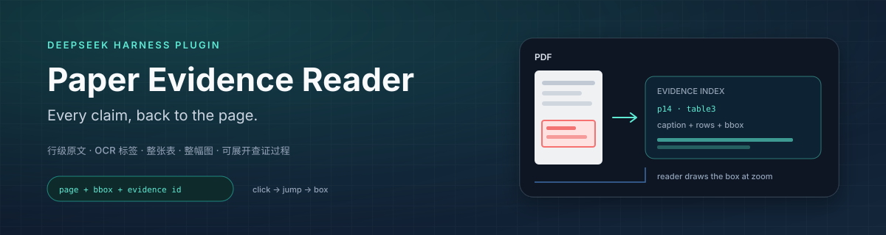
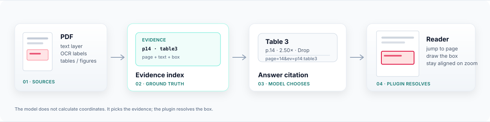

<p align="center">
  <a href="README.md">English</a> · <strong>简体中文</strong>
</p>

<p align="center">
  
</p>

<p align="center">
  <a href="https://github.com/Raymond2967/dsh-paper-reader-evidence/actions/workflows/ci.yml"></a>
  <a href="https://github.com/Raymond2967/dsh-paper-reader-evidence/releases/tag/v1.1.4"></a>
  <a href="https://github.com/deepseek-ai/deepseek-harness"></a>
  <a href="LICENSE"></a>
</p>

<p align="center"><sub>CI = GitHub Actions 构建状态 · release = 插件版本 · harness = 运行时兼容 · MIT = 开源许可证</sub></p>

<h1 align="center">dsh-paper-reader-evidence</h1>

<p align="center"><strong>让论文问答里的每一条结论，都能点回 PDF 原文的那一行、那张表或那幅图。</strong></p>

每条答案都会指向它实际使用的原文段落、表格或图片，并记录页码和页面上的位置。点击引用，阅读器会跳到那一页并框出原文；每条答案下方还有可展开的查证过程，能看到搜过哪些页、用了哪些证据。

> 基于 [`@ggboy123/dsh-paper-reader`](https://github.com/GGboya/dsh-paper-reader) v1.12.0（MIT）扩展。文献库、PDF 阅读器、翻译、笔记和伴读能力保留，新增证据索引、可点击引用和查证过程。

## 为什么

普通 PDF 问答通常只给页码。读者还要自己翻页、找表头、确认是哪一行——这不算真正可溯源。

| 普通回答 | Paper Evidence Reader |
| --- | --- |
| “Table 3 显示 Drop 最贵（第 14 页）” | 点击 **Table 3** → 跳到 p14，框住表题 + 整张表 |
| “Keep 最差 2.50×（第 14 页）” | 点击 **2.50×** → 框住对应表格行/单元格 |
| “Figure 2 说明 churn 的影响” | 点击 **Figure 2** → 框住整幅图 + 图注 |
| 读者自己核对 | 展开「查证过程」：查了哪些页、搜了什么、返回哪些证据、最终引用了哪些 |

## 你会得到什么

- **引用可点击**：正文行、OCR 标签、整张表、整幅图都可以点回原文。
- **该整块就整块**：问 `Table 3` / `Figure 2` 时框住整个对象，而不是只框一个数字。
- **查证过程**：展开答案，就能看到查过哪些页、返回哪些证据、最终引用了哪些。
- **缩放不跑偏**：缩放、滚动、重渲染后，框始终贴着实际 PDF 页面。

## 工作方式

<p align="center">
  
</p>

模型只负责选择证据；页码和坐标由插件解析，框由阅读器绘制；同一批工具调用也会生成答案下方的查证过程。模型不会猜坐标。

## 安装

### DeepSeek Harness 桌面端（npm 发布后）

1. 打开 **插件 → 添加插件**。
2. 粘贴 `dsh-paper-reader-evidence`。
3. 启用并重启 Harness。

不用克隆、不用构建。npm 包目前还没发布；在那之前用下面的本地方式。

### 命令行

```bash
dsh plugin --profile web add dsh-paper-reader-evidence
```

### 从当前仓库安装（现在可用）

<details>
<summary>从源码构建（开发者）</summary>

```bash
git clone https://github.com/Raymond2967/dsh-paper-reader-evidence.git
cd dsh-paper-reader-evidence
pnpm install
pnpm run build
dsh plugin --profile web add .
```

也可以构建 `.tgz`，通过桌面端插件管理器安装。

</details>

## 使用

1. 侧栏底部打开 **📚 论文伴读**。
2. 新建专题并上传 PDF，或把 PDF 放到 `<dataDir>/<专题>/<文献名>/<文献名>.pdf`。
3. 点论文打开阅读器，在右侧原生对话里提问。
4. 点击答案中的证据链接：阅读器跳页并框选；缩放后框仍对齐。
5. 展开答案底部的「查过 P…，取回…条证据，最终引用…处」。

示例问题：

```text
这篇论文的核心贡献是什么？
Table 3 的实验结果说明了什么？
Figure 2 的趋势怎么解释？
作者为什么认为 Keep 策略不够？
这篇论文和同类方法的关键区别是什么？
```

问整张表/整幅图时，模型会优先引用整块证据；只问单个数值时，引用行级/单元格证据。

## 环境与依赖

- DeepSeek Harness `0.2.x`（当前验证 `0.2.2-rc.1`）
- Node.js `^22.19.0 || >=24`（由 Harness 提供）
- 普通文本层 PDF：开箱即用
- **OCR 标签**：Windows + 简体中文 OCR 语言包
- **坐标索引**：Python 3.11+ 与 `pymupdf`

缺少 OCR/Python 时，阅读器仍可转录、检索和按页跳转，但图片上的标签只能「仅定位到页」。

## 数据与隐私

- 文献库默认 `~/.dsh-paper-reader/data`
- 证据索引：`<文献>.evidence.json`
- OCR 页图缓存：`.evidence-cache/`
- 工具审计：`<dataDir>/.paper-reader/audit/<sessionId>.jsonl`
- OCR、版面检测和索引全部在本机完成；插件不会上传 PDF。

## 配置

在 profile 的 `cordis.patch.yml` 中可以设置：

```yaml
- id: dsh-paper-reader-evidence
  name: dsh-paper-reader-evidence
  config:
    dataDir: 'D:\papers'
    # topic（默认）= 一个专题一个工作区；paper = 旧的一篇论文一个工作区
    workspaceScope: topic
```

## 已知边界

- 普通证据以**行级/标签级**为主；跨行句子只框命中那一行。
- 整表/整图依赖 PDF 版面和 `Table N:` / `Figure N:` 标题；无边框表、无图注的图可能退化为行级证据。
- 多页表通常只框当前页。
- OCR 依赖 Windows 简体中文语言包。
- 查证过程只记录本插件 PDF 工具，不记录模型内部思考或其他工具。
- 没有工具调用的回答不会显示过程面板。

## 开发

```bash
pnpm install
pnpm run typecheck
pnpm run build
```

`src/` 是 TypeScript 源码；`lib/`、`reader/`、`runtime/` 是运行时静态资源。构建后重启 Harness profile 生效。

## License

MIT。原始项目版权归 GGboya；本扩展的修改部分归 Raymond。详见 [LICENSE](LICENSE) 与 [NOTICE](NOTICE)。

